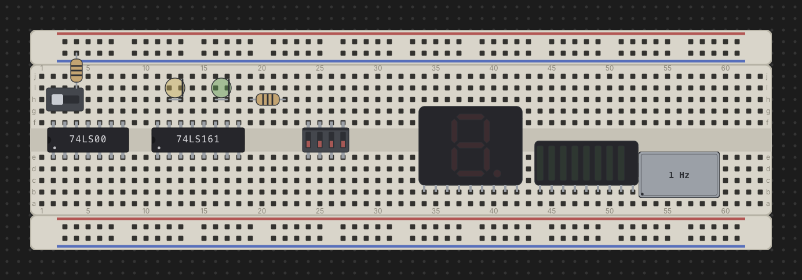

# Chips & Components

Everything that isn't a breadboard strip lives in the **Parts** palette on the
left: 74LS and CD4000 logic chips, CPUs, 65xx interface chips, memory chips, switches, LEDs,
displays, resistors, capacitors, inductors, diodes, transistors, oscillators, the 555 timer,
and power/clock bricks. This page covers
finding a part, seating it on a board, and the (surprisingly varied) ways
different parts rotate and flip once they're down.

## The parts palette

The palette opens with every section collapsed, grouped by function:

- **BOARDS** — the breadboard kits and loose strips, pinned at the top (see
  [The Desk & Breadboards](the-desk.md)).
- **CHIPS** — the logic chips, folder-grouped by function, ending with the
  **Timer** group (the **555 timer**), the **Op-amps** group (the **LM358**),
  the **Interface** group (the 65xx PIA/VIA, the **ULN2003A** Darlington
  array and the **4N35** and **PC817** optocouplers) and the **PROCESSOR**
  group (the W65C02 and Z80A CPUs). Which logic
  family it shows — 74LS, CD4000, or both, each in a folder of its own — is
  **Settings → Data Sheets → Chip family** (see
  [Choosing a logic family](chip-library.md#choosing-a-logic-family)). The 555
  belongs to neither family, so it shows in every mode; showing CD4000 alone,
  it shares the **Timer** group with the CD4000 timers.
- **COMPONENTS** — **Switches**, **Resistors**, **Capacitors**,
  **Inductors**, **Diodes**, **Transistors**, **Relays**, **LEDs**,
  **Displays**, **I/O**, **Audio**, **Oscillators**, **Regulators** and **Power**, in
  that shelf order. Capacitors, Inductors,
  Diodes and Transistors carry a red **(i)** beside their names: in the
  digital engine these parts do only part of what the real ones do, and are
  there for the export and a complete design (see
  [Inductors, diodes and transistors](#inductors-diodes-and-transistors)).
  With **Spice Lite** on they are simulated for real, and the **(i)** goes.
  Two parts are there only while **Spice Lite** is on, because the standard
  engine can't simulate them at all: the **speaker** (**Audio**) and the
  **electronic load** (**Power**). One already on a desk stays there either
  way, and searching for one with Spice Lite off says where to turn it on.
- **Memory** — the ROM/RAM chips, pulled out of CHIPS into a top-level group
  of their own.
- **ANNOTATIONS** — labels and notes (see
  [Probing & Net Names](probing.md#annotations)).
- **SIGNALS** — bench stimulus buttons, pinned at the bottom (see
  [External signals](power-and-clocks.md#external-signals)).

With the tray shut, the strip it leaves on the desk's edge carries one icon per
section in the same order — click one to open the tray on that section alone.
To keep the tray down to one section all the time, turn on **Auto-close tray
folders** in [Settings](settings.md#appearance): opening any folder then
closes the rest.

The tray's right edge is a drag handle: pull it out to give long part names
more room, and the width you leave it at is remembered.

Type in the **Filter parts…** box to search by id, title, or description —
matching, it forces every group open so results aren't hidden behind a
collapsed folder. Click any entry to arm placement — a ghost of the part
follows your pointer until you click it down on a board, or press `Esc` to
cancel.

## Placing a DIP chip

A DIP chip always straddles the trench: half its pins seat in row **e**,
the other half in row **f**, running the standard counterclockwise DIP
numbering — pin 1 at the anchor hole in row e, pins continuing left to right
along e, then wrapping back right to left along f. The **notch** end of the
chip (or the dot beside pin 1) marks pin 1 and always faces left. Move the
ghost over a pin-board and it snaps to the nearest legal seat; it turns red
if the seat is already occupied or falls off the edge of the board.

The **wide chips** — the 24-, 28-, 32- and 40-pin packages: the memories, the
6502 and its peripherals, the Z80 and the 74LS181 — are 0.6 inch across, twice
a small chip, and seat at that true width, their two rows of pins six holes
apart across the trench. There are four ways to do that, and the chip takes
whichever is nearest the pointer as you place or drag it:

| Pin 1's row | Other row | Body covers |
|---|---|---|
| **e** | **i** | f, g, h |
| **d** | **h** | e, f, g |
| **c** | **g** | d, e, f |
| **b** | **f** | c, d, e |

Every one makes the same connections — each half-column is one connected
strip — so pick the one that leaves room for your wiring. The chip's body
covers the three rows between its pins, so those holes can't take a wire or
another part's lead; wire to each pin from the rows outside it instead. A
dragged chip moves from one seat to the next as the pointer travels, wherever
you took hold of it. A desk saved before wide chips seated this way keeps them
in rows e and f just as they were; move one on its own and it takes its true
width, bringing the wires plugged into it out from under its body.

Because a chip's footprint is the same two rows no matter how it's turned,
placing one is a matter of picking the column — there's no click-to-rotate
step while placing a chip the way there is for a rail or a resistor; instead,
rotation happens afterward (see below).

## Placing a discrete

Most discretes — slide switches, push buttons, toggle buttons, LEDs (in
their default horizontal form) and LED bars (bar8) — are **linear**: they seat along a run of adjacent holes in any
single grid row (any of `a`–`j`), not just rows e/f. Drop one anywhere its
footprint fits and every free hole underneath it is available.

A few parts don't fit that linear model:

- **7-segment displays** (**seg7cc**, common cathode; **seg7ca**, common
  anode) are the real single-digit 0.56-in part: ten legs, five along the top
  and five along the bottom, 0.6 in apart, so each straddles the trench like a
  wide (600-mil) chip — five legs in row `d`, five in row `h` (or `b`/`f`,
  `c`/`g`, `e`/`i`), its body over the rows between. Pin 1 is bottom-left,
  counting round anticlockwise: 1 e, 2 d, 3 COM, 4 c, 5 dp, 6 b, 7 a, 8 COM,
  9 f, 10 g — the common comes out twice, joined inside, so wire either. Common
  cathode: COM to ground, drive a segment HIGH (a CD4511B's way); common
  anode: COM to +V, pull a segment LOW (a 74LS47's). Give each segment its own
  resistor. `R` turns it end for end. The older single-row **8-segment
  digits** (seg8cc, seg8ca) are retired: they are gone from the tray, but a
  desk that has one still loads and runs it.
- **bar8iso** — the isolated 8-segment LED bar — is packaged as a 16-pin
  DIP, so it straddles the trench exactly like a chip: anodes A1–A8 in row
  e, cathodes K1–K8 in row f.
- **DIP switch banks** (**sw-dip1**, **sw-dip2**, **sw-dip4**, **sw-dip8**)
  are likewise DIP-packaged (2/4/8/16 pins for 1/2/4/8 switch positions),
  straddling the trench the same way: each position's two facing pins —
  one in row e, one in row f — are its own independent SPST switch.
- **Oscillator cans** (**osc-full**, **osc-half**) are rigid four-cornered
  shapes rather than a line of pins — a full can is 7 holes by 4, a half
  can 4 holes square, with legs only at the four corners. A can can seat
  anywhere on the grid, including straddling the trench, since its shape
  (not a row) determines its footprint.
- **Character LCD modules** (**lcd16x2**, **lcd20x4**) _are_ linear — a
  16-way header along 16 adjacent holes in one row — but the module itself
  is much bigger than that row. See below.

## Component values

A **resistor** has a **Resistance**, a **capacitor** a **Capacitance**, an
**inductor** an **Inductance**, a **Zener diode** a **Zener voltage** and a
**transistor** a **Part number**. Right-click the part, choose
**Properties…**, and either pick from the field's list — the ▾ beside it, or
↓ — or type any value at all, the way it is printed on a parts drawer or a
schematic. Typing narrows the list to the entries holding what you have typed
(`4` leaves 47Ω, 470Ω, 4.7kΩ, 47kΩ and 470kΩ; `u` finds µ).

| Typed                                   | Reads as    |
| --------------------------------------- | ----------- |
| `470`, `470R`, `470Ω`, `470 ohms`       | 470Ω        |
| `4.7k`, `4k7`, `4.7 k`, `4.7 kilo ohms` | 4.7kΩ       |
| `1M`, `1meg`, `2M2`                     | 1MΩ, 2.2MΩ  |
| `2R2`, `0.47`                           | 2.2Ω, 0.47Ω |
| `100n`, `100nF`, `0.1uF`, `0.1µF`       | 100nF       |
| `4n7`, `10 microfarads`                 | 4.7nF, 10µF |
| `10uH`, `1 millihenry`                  | 10µH, 1mH   |
| `5.1`, `5.1V`, `5V1`                    | 5.1V        |

A plain number is in the field's own unit — ohms, farads, henries or volts —
so `100` in a Capacitance is a hundred farads, which is out of range and says
so. The prefixes are `p` `n` `u`/`µ` `m` `k` `M` `G`, or spelled out (`pico`
… `giga`, and `meg` as SPICE writes it). A lowercase `m` is always milli and
an uppercase `M` always mega: `1m` on a resistor is a milliohm, refused as out
of range rather than guessed at. A prefix letter — or `R` for ohms, `V` for
volts — can stand in for the decimal point (`4k7`, `2R2`, `4n7`, `5V1`). A
unit belonging to something else is refused by name: `10uF` in a Resistance
is "a capacitance, not a resistance".

Press Enter or move out of the field to apply it. A value that reads is shown
back in its tidy form — `100 kilo ohms` becomes `100kΩ` — to three figures,
or to as many as you typed (`4753` is `4.753kΩ`; nothing is rounded away). One
that doesn't stays as you typed it, in red with the reason under it ("Not a
resistance value", "Out of range: 0.1Ω to 100MΩ"), and the part keeps the
value it had. Any value in range is taken, on the list or not.

| Field                      | Range         | List                                     |
| -------------------------- | ------------- | ---------------------------------------- |
| Resistance                 | 0.1Ω – 100MΩ  | the E12 series, 10Ω – 1MΩ                |
| Capacitance (ceramic)      | 1pF – 100µF   | 10pF – 1µF                               |
| Capacitance (electrolytic) | 100nF – 100mF | 1µF – 1mF                                |
| Inductance                 | 1nH – 10H     | 1µH – 680µH and 1mH – 100mH, in E6 steps |
| Zener voltage              | 1.8V – 200V   | 2.4V – 30V, each with its part           |

When the value a part holds is not a **standard** one — one it is actually
made in — a small amber **ⓘ** appears to the right of the field. Click it
for the standard values either side (`3k` offers **2.7kΩ** and **3.3kΩ**;
a value past the end of the series, the one end it is past), and click one
to take it. It is advice, never a fault: a value that is not standard is
still taken exactly as typed, and a click anywhere else, or Escape, puts the
card away. Resistors and capacitors are measured against the **E12** series
across their whole range (so `4.7n` is standard though the list does not
offer it), a potentiometer against the track values pots are sold in, and an
inductor or a Zener against its own list.

A **Zener**'s list pairs each voltage with its part — `5.1V (1N4733A)` — and
picking one sets both. Typing a voltage on the list (`5.1`, `5V1`) brings its
part number with it, typing a part number on it (`1n4742`) picks its entry,
and any other voltage stands alone, with no part number.

A capacitor's **Type** (Ceramic or Electrolytic) and a transistor's **Type**
(NPN, PNP, N- or P-channel MOSFET) swap the part where it stands and reopen
its card as the new one; like any change to the wiring, the Type is greyed
while the circuit runs. The value comes across untouched, so a capacitance
outside the new type's range shows red rather than being changed. A
transistor's list holds the parts of its own type, and a part number from
another type's list is cleared by the swap (one you typed yourself is kept).
Typing another type's part number is allowed, with a warning — `2N3906 is a
PNP transistor`.

An older project's values load as they were. One that cannot be read is kept
exactly as written, and shows red when you open the card.

On the desk a resistor wears its **colour code** — four bands for a value two
figures say (`4.7k`: yellow, violet, red, gold), five for one that needs three
(`4.99k`) — and a capacitor has its value printed on it. Both values appear in
the [Schematic View](schematic-view.md), the [BOM](build-guide.md), and the
[KiCad export](exporting.md#kicad).

A resistor's value changes nothing in the simulation: a resistor is a weak pull
whatever it measures, and a lamp is lit or burnt by whether one is in the
loop. Only the timing chips read it (below).

## Potentiometers

**COMPONENTS ▸ Resistors ▸ Potentiometer** is a three-pin trimmer: a
resistive track between the two outer pins and a **wiper** on the middle pin
that taps it. It seats along one row like a switch, pins 1, W and 3 in three
holes side by side. Press `R` while placing it, or with it selected, to turn
it end-for-end: pins 1 and 3 swap ends and its screw swings to the other side.

Its **Properties…** card has the track's **Resistance** — picked from the
values pots are sold in (100 Ω, 200 Ω, 500 Ω, 1 kΩ … 22 kΩ, 25 kΩ, 47 kΩ,
50 kΩ … 1 MΩ, 2 MΩ) or typed like any resistor's — and the wiper's **Position**, a slider from 0 % to 100 %. The
resistance from the wiper to pin 1 is Position × Resistance, and to pin 3 is
what is left of the track:

| Position | Wiper ↔ pin 1 | Wiper ↔ pin 3 |
| -------- | ------------- | ------------- |
| 0 %      | 0 — a wire    | 100k          |
| 10 %     | 10k           | 90k           |
| 50 %     | 50k           | 50k           |
| 90 %     | 90k           | 10k           |
| 100 %    | 100k          | 0 — a wire    |

(for a 100k part). The slider shows exactly that as you move it — the
resistance to pin 1 at its left end and to pin 3 at its right, `15k ━●━━━ 85k`
— and changing the Resistance updates both. It applies as you drag it, while the
circuit runs as well, and the brass screw on the part turns to show where the
wiper is.

Each side with track left behaves exactly like a resistor: a weak pull, and a
value the timing chips read — a pot as a 555's RB tunes its rate. A side with
**none** left is the wiper resting on that pin: a plain wire, so the two nets
join, and an LED fed through it with nothing else in the loop **burns**.

## Capacitors

**COMPONENTS ▸ Capacitors** holds two:

- **Capacitor (ceramic)** — a disc, not polarised, leads one hole apart.
- **Capacitor (electrolytic)** — a can with a stripe down its **negative**
  side, leads one hole apart. Pin 1 is `+`, pin 2 is `−`.

Both place, rotate and bend exactly like a resistor (see
[Rotating & flipping](#rotating--flipping)), and they take holes the way any
part does, so a wire or a pin can't share one.

**A capacitor carries a value, not charge.** It does not filter, smooth,
decouple or store anything, and it connects nothing: the simulation treats it
as open, even when its legs sit across the two rails. What it is for is the
**timing chips** — the 555, the CD4047B, the CD4060B, the CD4098B and the
CD4538B read the capacitor (and the resistors) wired to their timing pins and
run at the rate the datasheet gives for those values; see
[Timers](chip-library.md#timers). A capacitor still counts as connected when
the checks ask whether a net has anything on it.

A reversed electrolytic makes no difference to the simulation. Watch the
stripe anyway if you mean to build it.

The first time you place a capacitor a note says all this; **Don't show
again** puts it away for good.

## Inductors, diodes and transistors

On the standard engine these parts do as much as a logic simulator can
honestly do, and no more: no forward drop, no gain, no thresholds, no Zener
breakdown, no inductive kick. [Spice Lite](spice-lite.md#diodes-and-transistors)
simulates all of those. What they always do is **export to KiCad as the real part** (see
[Exporting](exporting.md#kicad)). Every one of them — and the capacitors —
has an optional **Part number** in **Properties…** (`1N4148`, `2N2222`,
`2N7000`…). It is printed on the part, listed in the
[BOM](build-guide.md) and written to the export, and it changes nothing about
how the part behaves.

**Inductors** (**COMPONENTS ▸ Inductors**) take an optional **Inductance**
(see [Component values](#component-values)); leave it blank for a bare
inductor.
Its **Style** is the part it is, seen from above like everything on the
desk: a **Coil** — a toroid standing on edge over its leads, copper wound
round a dark ferrite ring — or a **Can**, a drum in a black sleeve, its value
printed on top. **Holes between
leads** is **1** (leads 0.2 in apart, the smallest part), **2** (0.3 in, the
default) or **3** (0.4 in, the biggest). On a part lying along a row it moves
the second lead, so a size whose lead would land on a taken hole, or off the
end of the board, is refused — with the reason under the choice — and the
choice is greyed while the circuit runs, like any other change to the
wiring. On the standard engine an inductor **conducts
like a wire**: its two leads are one net, whatever it looks like. So one
across the rails is a short, exactly as a wire would be. Under
[Spice Lite](spice-lite.md#inductors) one with an Inductance is a real
inductor, and its card gains a **Winding** choice.

**Diodes** (**COMPONENTS ▸ Diodes**) are the **Diode** and the **Zener
diode**. Pin 1 is the anode; pin 2, the cathode, is the end the band marks. A
diode is placed across four holes, like a resistor, but its body is shorter,
so its leads bend down to **three** (`a10` to `a12`) — drag a leg in with
`Option`. A diode is **one-way**: a HIGH on its anode passes to its cathode, and nothing
ever passes back. A LOW or undriven anode leaves the cathode to whatever else
is on it — so two diodes into one net, with a pull-down resistor there, make a
**diode-OR**. The HIGH passes at the strength it arrived with: from a rail or a
chip output it drives the cathode, through a resistor it only pulls it. Like an
LED, a diode wired forward straight across two strongly driven nets (rail to
rail, or an output into ground) **burns**. A Zener takes an optional **Zener
voltage**, picked with its part number or typed (see
[Component values](#component-values)), printed and exported, but in
the simulation it is exactly a diode: reverse breakdown is analog, so it
regulates nothing here.

**Transistors** (**COMPONENTS ▸ Transistors**) are an **NPN** and a **PNP**
bipolar transistor and an **N-channel** and a **P-channel MOSFET**, each
standing over three holes in a row with its pin letters printed on it: `E B C`
for the BJTs, `S G D` for the MOSFETs. A BJT is a **TO-92** unless you pick
**TO-220** (a TIP120 or a TIP31C) under **Package** in its **Properties…**; a
MOSFET is a **TO-220** — the power part, its metal tab behind it — unless you
pick **TO-92**. The package is how it is drawn, listed in the BOM and
exported; on the standard engine it is never how it behaves (under
[Spice Lite](spice-lite.md#diodes-and-transistors) it picks the default
**Grade**). Its **Type** turns it into any of the four where it stands.
Picking a part number from the list sets its package (and, under Spice Lite,
its grade) to match. Real pinouts differ by part number
(a 2N2222 is E·B·C, a BC547 C·B·E, an IRLZ44N G·D·S), so select one and press
`R` to turn it end-for-end.

A **TO-92's legs bend**, as the real ones do: hold **`Option`** (`Alt`) and
drag one leg to any free hole — the other two stay where they are, and the
body stands over the middle of its legs. Drag the transistor by its body and it
moves whole, every leg keeping its bend; `R` still turns it end-for-end (pins 1
and 3 trade holes); a leg plugged in beside a chip you drag bends after it, as
a resistor's does. Put the three legs back in three holes in a row, in order,
and it is the straight part again. A **TO-220's** legs are a rigid row, so
they never bend — and while a TO-92's legs are bent, **TO-220** is greyed under
**Package** (hover it for why) until they stand in a row again.

In the simulation each transistor is a **switch**:

| Part             | Control  | Joins                         | On while the control is |
| ---------------- | -------- | ----------------------------- | ----------------------- |
| NPN              | Base `B` | Collector `C` and emitter `E` | HIGH                    |
| PNP              | Base `B` | Emitter `E` and collector `C` | LOW                     |
| N-channel MOSFET | Gate `G` | Drain `D` and source `S`      | HIGH                    |
| P-channel MOSFET | Gate `G` | Source `S` and drain `D`      | LOW                     |

When it is on, the two switched pins are joined as a closed switch joins them;
when it is off, they are apart. What an **undriven** or undefined control does
is where the two kinds differ, as they do on a bench:

- A **BJT** follows its base and remembers nothing: with its base floating or
  undefined it is **off**.
- A **MOSFET's gate holds charge**: it stays in the last state its gate was
  driven to — **off** until the gate has been driven at all. So a gate left
  floating (or driven by a floating CMOS output) keeps the MOSFET on or off
  rather than passing the confusion down the channel. While it runs on that
  held charge, the lamp on its face is ringed in amber, its hover says so, and
  its **Properties…** card warns you: a real gate leaks that charge away, so
  tie it to a defined level with a resistor.

While the circuit runs, a transistor's lamp lights while it conducts. Put a
resistor in an LED's leg as you would on a bench — with none, the LED burns —
and a transistor switched on straight across the rails is a short.

A pin wired only to one of these parts **counts as connected**, conducting
or not: a reversed diode or an off transistor is a valid board, not a floating
input. Supplies don't pass through them, though — a chip powered through a
diode or a transistor sees no supply and stays unpowered.

## Regulators, relays and the electronic load

These are the parts a bench uses to power and switch things rather than to
compute. Each does what a logic simulator honestly can on the standard engine,
and what it really does under [Spice Lite](spice-lite.md#bench-parts).

**Regulators** (**COMPONENTS ▸ Regulators**) are the **LM7805**, **LM7809**,
**LM7812** and **LM7815** fixed regulators and the **LM317** adjustable one,
each a TO-220 standing over three holes in a row. A 78xx's legs are
`IN · GND · OUT` from the left; an LM317's are `ADJ · OUT · IN`, and two
resistors set its output — **R1** from OUT to ADJ (240 Ω is usual) and **R2**
from ADJ to ground, for **Vout = 1.25 V × (1 + R2 / R1)**: 240 Ω and 390 Ω make
3.3 V. Press `R` while placing one, or with it selected, to turn it
end-for-end: its tab swings to the front and its legs read `OUT · GND · IN`
(`IN · OUT · ADJ` for an LM317) from the left.
On the standard engine a regulator's output **is a supply** — chips on it are
powered, like chips on a rail — whenever its input is a supply at least its
**dropout** above what it holds (2 V for a 78xx, 1.7 V for the LM317); below
that its output is nothing. Regulators chain: a 7805 fed from a 7812's output
works.

**The relay** (**COMPONENTS ▸ Relays**) is a 5 V SPDT relay — the blue cube
of a Songle SRD — over five holes in a row: **COIL+**, **COIL−**, **COM**,
**NO**, **NC** (`C+ C− COM NO NC` on its face). Its **Coil voltage** in
**Properties…** is 5 V or 12 V. The coil has no polarity. On the standard
engine COM is joined to **NO** while one coil leg is HIGH and the other LOW,
and to **NC** otherwise; its lamp lights while it is pulled in. A real coil
wants about 70 mA at 5 V — more than a logic output gives — so drive it from a
transistor or a ULN2003A, with a diode across the coil. Press `R` while
placing it, or with it selected, to turn it end-for-end: the cube swings to
the other side of its row, `NC` now at the left.

**The electronic load** (**COMPONENTS ▸ Power**) is a bench brick like the
power supply, with a red **`+`** and a black **`−`**: wire them across a
supply, a rail or a regulator's output to draw a current from it on purpose.
Its **Mode** is **CC** — constant current, its **Current** from 1 mA to 5 A —
or **CR**, constant resistance, its **Resistance** from 0.1 Ω to 100 kΩ; its
badge shows the setting. It draws nothing on the standard engine (a logic
simulator has no currents); under Spice Lite it shows the volts, amps and
watts it is taking. It is left out of a KiCad export, since it is an
instrument rather than part of the circuit.

## The speaker

The **speaker** (**COMPONENTS ▸ Audio**, shown while
[Spice Lite](spice-lite.md#speakers) is on) is a small 12 mm PCB speaker on
two legs 0.3 in apart, its round body standing over the rows behind them.
Press `R` (while placing it, or with it selected) to turn it a quarter turn
about its `+` leg: 0.3 in is the channel's own width, so stood on end it
straddles the trench — one leg in row `e`, the other in row `f`, the body
over the channel. Put a tone across it and you hear it: a 555 astable, a counter's output, a
clock brick. Its coil is only 8 Ω, so feed it through a resistor and a
capacitor (47 Ω and 100 µF from a 555's OUT), or from a transistor. Its
**Impedance** is 8, 16 or 32 Ω, and its **Volume** (0–100 %) sets how loud
it plays on top of the power the circuit puts into it. While it plays, the
ring round its cone lights and the cone shows the pitch (the circuit's own,
"456 Hz"), as does its hover.

It plays the circuit's pitch at the run's speed: at ×¼ a 440 Hz tone sounds
at 110 Hz, as everything else on the desk runs at a quarter of its speed.
Pause, Step or Stop and it falls silent. Its **pin-assignments window** has
an example with four desktops: a fixed **Tone**, **Pitch** on a pot, a
**Key** that sounds only while a button is held, and a two-tone **Siren**.

## The USB-serial adapter

The **USB-serial adapter** (**COMPONENTS ▸ I/O**) is an FTDI-style
breakout whose six-pin header plugs into one row of the board. Its USB cable
is a **Terminal** window (right-click ▸ **Open Terminal…**): what the circuit
sends on the adapter's RXD shows there, and what you type goes out on its
TXD, as real serial frames at the baud rate set on its Properties card. See
[Serial & the Terminal](serial-terminal.md) for the wiring, the settings and
its example, a serial transmitter built from 74LS parts.

## Character LCD modules

The **Displays** group holds two HD44780 character-LCD modules: a 16×2
(the standard 1602A) and a 20×4 (the 2004A). They're drawn to their real
sizes — 80 × 36 mm and 98 × 60 mm of PCB — and their screens are **live**:
run the circuit, drive the module, and the characters appear on the glass.

Both plug in through a **16-way header along one row**, and the pin
assignment is identical between them, so what you learn wiring one applies
to the other. The header runs along the module's **top** edge, which means
the body hangs **below** the row it plugs into — so seat one on a **bottom
row (`a`)** and it clears the board it's plugged into rather than covering
it. The placement ghost shows you the whole module, so you can see this
before you click.

Driving one is the ordinary HD44780 parallel bus: put a command or character
code on `DB0`–`DB7`, set `RS` (0 = instruction, 1 = data) and `R/W`
(0 = write), and pulse `E` — the byte latches on `E`'s falling edge. Wire
`VDD`/`VSS` to a 5 V rail. `V0` (contrast) and `A`/`K` (backlight) are
cosmetic in the standard engine; under [Spice Lite](spice-lite.md#character-lcds)
the backlight is an LED and `V0` sets the contrast. During a _read_ the
module drives `DB0`–`DB7` itself, so tri-state anything else sharing that
bus.

Both modules show the same controller datasheet in their pin-assignments
window — it's one document, because `RS`/`R/W`/`E`, the bus and the address
maps are the controller's and are identical across the two sizes.

## Rotating & flipping

Rotation behavior is **not one rule for every part** — it depends on what
kind of part it is. This is the part worth reading carefully.

**Chips (`R`, mid-drag or while selected).** A DIP chip's footprint maps
onto itself when flipped — same two rows, same columns — so flipping only
reverses which physical pin sits where; the chip never has to move. Select a
placed chip and press `R` to flip it 180° in place, or press `R` while
mid-drag to flip it before you drop it. Either way its pin-assignments
window updates to show the new numbering.

**bar8iso, the 7-segment displays and DIP switch banks (`R` while selected or
while placing).** These are DIP-packaged, so they flip exactly like a chip:
`R` turns the part 180° in place, the same holes, only the pin numbering
reverses (a switch bank's own position states don't move — position 1 is
still position 1, just wired to the opposite pins now). The drawing turns
with it: bar8iso's bar 1 and its pin-1 dot move to the far corner, a digit
stands on its head. None has the turn-in-hand behavior of a plain LED —
treat them as chips for rotation purposes.

**Resistor, capacitor, inductor, diode and LED (`R`, both while placing and once placed).** These
two-lead parts start in a horizontal **footprint** form (pin 1 and pin 2 a
fixed span apart along one row). Press `R` while the ghost is armed to turn
it into a vertical **two-free-ends** form instead: pin 1 stays at the anchor
hole, and pin 2 becomes a free lead that can land on any other free hole —
including a hole on a different strip entirely, such as reaching up to a
power rail. Each `R` press while placing steps the ghost a further quarter
turn, cycling through all four compass directions before repeating. Once the
part is placed, select it and press `R` to rotate it 90° at a time — pin 1
stays put and pin 2's lead swings around it, hunting for the next free hole
to land in. Where its own length has no hole that way (a part a row or two
from the channel or the board's edge), the lead takes the nearest length that
does — never shorter than the part's body allows (a diode's three holes, a
resistor's four) — and goes back to its own length on the next turn that has
room.

**Transistors, regulators, potentiometers, relays and the bar graph (bar8)
(`R` while selected, or while placing).** These turn end-for-end in place, as
the bussed resistor array does: the same holes, with the pin order reversed (`E B C` becomes `C B E`).
The body turns with them — a TO-92's flat face, a TO-220's tab, a trimmer's
screw, a relay's cube and the bar graph's block all swing to the other side
of the row — while the printing on it stays the right way up.

**Oscillator cans (`R`, but the exact step differs by state).** A can spins
around its own centre, not around one pin, and the step size changes
depending on whether you're still placing it:

- **While placing**, `R` steps the ghost a full 90° quarter-turn each
  press, so you can hunt through every orientation for one that fits.
- **Once seated and selected**, `R` behaves differently for the two sizes:
  the square **osc-half** can still steps 90° at a time, but the
  rectangular **osc-full** can jumps straight from 0° to 180° (and 90° to
  270°) — because a non-square footprint only has two genuinely distinct
  orientations once it's down (rotating it a further 90° would just retrace
  the same two footprints it already swept through while placing).

**LED polarity (`F`, while placing only).** Independent of rotation, press
`F` while an LED's placement ghost is armed to flip which lead is the anode
and which is the cathode, before you click it down.

## Moving a seated part — and its wiring

Drag a placed part and it moves **with everything plugged into it**. Every
wire end sitting in a column-half one of the part's pins occupies comes along,
keeping its own row and its offset from the part, so the circuit after the
move is the circuit before it. A wire with its other end somewhere else
**stretches** — that end stays put — so nothing is quietly disconnected.
(Moving the part alone would leave the wires in the holes you laid them in,
and what was pin 1's input would now be pin 3's.)

**A resistor or LED plugged into the part comes too — by the leg that is
connected to it.** A leg in one of the part's column-halves is attached to it
exactly as a jumper in the next hole along is, so it travels; the other leg
stays exactly where it is and the part simply **bends** around it, the way a
resistor's legs bend on a real bench. Plugged in at _both_ legs, it travels
whole instead. (A chip's pins can't bend, so a chip next door is never dragged
along — it isn't a lead, it's a body.)

Only what is actually connected to the part comes — a wire or a leg in a
column the part merely spans without having a pin there (a push button reaches
two holes three columns apart, not the one between them) is left alone,
because it was never connected to it. And nothing chases further than one
step: what travels lands in the same column-half its pin lands in, so a rider
never leaves anything of its own stranded behind it.

The drop is **all or nothing**. If any of those has nowhere to go — its hole
is taken by something that isn't moving, it would run off the end of the
strip, or the bend would squeeze a resistor's legs closer than its body is
long — the part _and_ everything it would have carried turn red, and releasing
puts everything back. Half a move would silently cut the connections it left
behind. The holes the part and its wiring are leaving count as free, so
sliding a chip one column along is fine even though its new pins overlap its
old ones. And where the part is drawn when you let go is where it lands: a
seat it showed you in green is the seat it takes.

A resistor or LED moves by its **body** whatever part of it you press — a leg
included — both legs together, carrying its wiring like any other part. To
move **one leg** on its own, hold **`Option`** (`Alt`) and drag that leg (see
[Selecting things](the-desk.md#one-leg-at-a-time--option)): it's a re-bend,
and carries nothing — that leg can land in any hole, at any angle, on any
strip, so there is nothing for a wire to follow.

### Moving a part bare — `Shift`

Sometimes leaving the wiring behind _is_ the point — you want to shuffle a
chip along and rewire it yourself. **Hold `Shift` as you press**, then drag:
the part moves on its own and every wire end and resistor or LED leg plugged
into its columns **stays in its hole**. Whatever the part's pins land on is
checked as usual, so a pin can't land in a hole a wire is still sitting in.
It's still one undo step.

`Shift` works on a whole selection too (see below): only the selected parts
move. A selected wire still moves — it was selected — and a selected board
still carries everything seated on it. A wire plugged into a power or clock
brick always travels with the brick, because it is plugged into the brick
itself.

Two details worth knowing:

- What comes along is decided when you **press**, not when you let go. Once
  the part is in hand, the set is fixed.
- Moving **across the trench** takes the wiring over with it, keeping the
  arrangement. Rows `a`–`e` and `f`–`j` are separate nodes, so a wire that
  stayed in its row would be left in the half its pin had just left — it
  travels the same number of holes the part did instead, so a wire two holes
  from the part is still two holes from it, on the same side. Drag far enough
  that the wiring would run off the edge of the board and the drop is refused;
  a row nearer the trench fits.
- Moving to **another board** works the same way — the wiring lands in the
  matching holes over there, and anything the wires reach back to stays where
  it is. While the part is over the gap between two boards there is nowhere for
  it to land, so the wiring sits where it really is and turns red until the
  part is over holes again.

### Moving several parts at once

A selection drags as one unit. Draw a box around a group of parts, or add them
one at a time with `Cmd`/`Ctrl`-click, then drag any one of them: everything
selected travels by the same amount, keeping the arrangement exactly as you
built it. Power and clock bricks count as parts here, and come too; so do
selected **wires** (moved rigidly, both ends) and selected **boards** (with
everything seated on them).

Everything above applies unchanged, just to the whole group:

- The wiring comes with it — every wire, and every resistor or LED leg,
  riding _any_ member. A wire between two selected parts travels at both ends;
  one that leaves the group stretches, keeping its far end where it is; a
  resistor plugged into a member bends after it exactly as above.
- The thing under your pointer snaps to the hole grid, and everything else
  moves by exactly the same step.
- The drop is **all or nothing**. If one part, one wire end, one leg or one
  board has nowhere to land, everything turns red and releasing puts the lot
  back — a group that dropped some of its members would be a rearrangement you
  never asked for.
- The whole move is **one undo step**.
- **Hold `Shift`** as you press to move the selection **bare**: only what you
  selected moves, and the wiring plugged into it stays where it is.

A plain click inside a selection narrows it to what you clicked, exactly as
clicking a part outside one does.

## Occupancy — one hole, one lead

Every hole on a breadboard — and every terminal on a power/clock brick —
holds **at most one lead**, whether that's a chip pin or a wire end. Placing
a part checks every one of its derived pin positions against every other
part and every wire already on the desk; if any pin would land on an
occupied hole, or off the edge of a board entirely, the ghost turns red and
the drop is refused. This is the same rule a wire's endpoints follow (see
[Wiring, Nets & Buses](wiring.md)) — chips, discretes, and wires all compete
for the same holes, with no separate bookkeeping for any of them.

A rotated resistor or LED's free lead is the one case where a pin can
legally resolve to **nothing** — if you later move or delete the strip
under that lead, the part stays exactly where it is and that leg simply
floats, unconnected, just as it would on a real bench.

## The pin-assignments window

Right-click any placed part — chip, discrete, or brick — and choose
**Pin Assignment**, at the top of its context menu, to open its floating
pin-assignments window: a diagram of every pin/terminal and, for
most chips, a cropped datasheet excerpt below it. A real chip's diagram
stays fixed at its canonical layout no matter how you've flipped it on the
desk (it matches the physical part, not the placement); a DIP-packaged
discrete — `bar8iso` or any DIP switch bank — is the exception: its diagram
reflects its current `R` flip, since it has no real notch of its own. See
[The Chip Library](chip-library.md) for the full
detail on what the window shows and how it sources its datasheet crops.

---

See also: [The Desk & Breadboards](the-desk.md) for how boards and strips
work, and [Wiring, Nets & Buses](wiring.md) for connecting components
together once they're placed.
