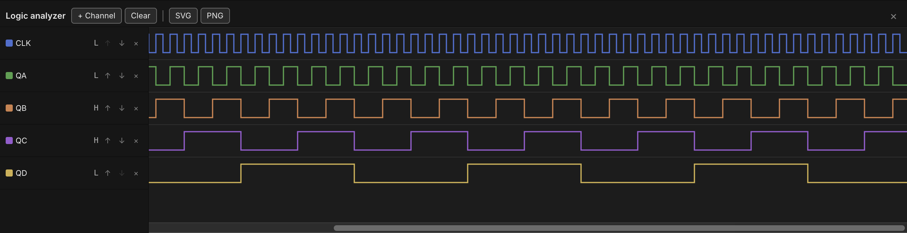

# Logic Analyzer & Timing

The **Analyzer** is a bottom-docked panel that records the live simulation
and draws it as a scrolling timing diagram — one lane per signal you've
chosen to watch, a step waveform for a single net or a hex value-lane for a
bus, with two draggable cursors for measuring the time between two points.
It's a passive recorder: it reads the same broadcast the LEDs and chip
badges already render from, so opening it, closing it, or adding channels
never changes how the circuit behaves.

## Opening the analyzer

Click **Analyzer** in the toolbar, or press `A` — a bare key, like the desk's
other tool letters, since `Cmd/Ctrl+A` is Select All — to dock the panel
along the bottom of the window. Click the button again, press the shortcut
again, or click the panel's **×** to close it — the panel remembers whether
it was open and how tall you left it (drag its top edge to resize, from a
compact strip up to half the window).

With no channels added yet, the panel shows a prompt instead of an empty
grid: **add a net or bus**, or right-click a probed net and choose **Add to
analyzer**.

## Adding a channel

There are two ways to add a channel:

- **From the panel** — click **+ Channel** in the header. The menu lists
  every _named_ net (see [Probing & Net Names](probing.md)) and every bus in
  the document that isn't already on a channel; picking one adds it.
- **From the probe tool** — arm the probe (`I`), right-click any net on the
  desk, and choose **Add to analyzer**. This works on ANY net the probe can
  reach, named or not — it's the way to watch a signal you haven't bothered
  to name. Using it also opens the panel automatically if it was closed.

Each channel gets a row in the left-hand gutter: a color dot (cycled from a
fixed palette unless the channel has its own color — either way the channel
keeps it wherever you move it), the net or bus name, its current value, and
three small controls — **↑** / **↓** to move the channel one row, and **×**
to remove it.

To move a channel further, **drag its row** up or down the gutter. The rows
and their waveforms make room as you go, so you see the new order before you
let go; drop the row where you want it, or press `Esc` to put it back. Hold
it against the top or bottom of the list to scroll a long list along.
Reordering works while the simulation runs, too.

Channels are saved with the document (`doc.scopeChannels`), so a desktop
reopens with its analyzer setup intact, and adding/removing/reordering a
channel rides the normal undo/redo stack — a drag is one undo step. A channel that loses its target (the net was deleted, the bus was
removed) simply reads as undriven rather than disappearing — it comes back
to life if the target returns.

## Reading a waveform

A single-bit channel (a **net**) draws as a step waveform inside its lane:

- **High** traces along the top of the lane, **Low** along the bottom.
- **Floating (Z)** draws a dashed line through the lane's midline.
- **Unknown/conflict (X)** — including anywhere the net is undriven — fills
  the region with a diagonal amber hatch instead of a line. Under
  [Spice Lite](spice-lite.md) there is no hatch: the lane draws the voltage
  itself, and a net reads X wherever its voltage sits between two inputs'
  thresholds — a 555's timing capacitor between ⅓ and ⅔ of its supply, all
  cycle long — which the trace already shows.

The gutter's value column always shows the channel's current level (or its
value at cursor A, once one is placed — see below).

With [Spice Lite](spice-lite.md) on, a net with a **voltage** — every net
something holds — draws that voltage instead: 0 V along the bottom of the
lane, the highest supply on the desk along the top. A channel that goes
below 0 V or above that supply (an
[AC supply](spice-lite.md#ac-supplies-and-transformers), a coil's kick)
widens its own lane to take it in, at a round figure, and never narrows it
again during the run; a lane that reaches below 0 V draws a dashed line at
0 V. A capacitor is seen to
curve up toward its supply rather than to jump from Low to High, a 74LS
signal swings between about 0.2 V and 4.4 V, and the value column reads in
volts (`3.16 V`). While a voltage is moving, Spice Lite samples it thirty
times a simulated second (a wave from a clock brick, sixteen times a period),
and the analyzer joins those samples into its curve. Once the voltage is within
the **Settle gap** (Settings ▸ Spice Lite) of where it is heading, Spice Lite
stops sampling it, and the lane holds it flat until the next thing that moves
it — so a switch thrown after a quiet second draws as a step, not a ramp.

## Timing and Transitions

The **Timing | Transitions** picker beside the panel's title chooses how the
trace is laid across the lanes. Both draw the same recording, so you can switch
back and forth, running or stopped; the analyzer remembers which one you left
it on.

### Timing

Across is **simulated time**. Each sample sits at the moment it was taken, so a
clock's halves are as long as each other, a PWM's short half is short, and the
gap between two switch presses is as wide as the time between them. Faint
vertical lines mark the **divisions**, and the header shows how much time one
division is (`5 ms/div`):

- **−** and **+** step the scale coarser or finer, 1-2-5 at a time, from
  100 ns to 5000 s a division.
- `Cmd/Ctrl`+scroll (or a trackpad pinch) over the lanes zooms the same way,
  about the point under the pointer — the way to zoom into one edge.
- **Fit** (lit while it is on) picks the finest scale that shows the whole
  trace in the panel and keeps doing so as the run goes on. It is where a new
  analyzer starts; pressing − or + leaves it, and the scale then stays where
  you put it, run after run, until you press Fit again (a restart begins at
Fit).

A scale too fine to hold the whole trace (more than about 16 million pixels
of it) is refused, and if a long run at a fixed scale grows past that, the
scale steps out to keep it.

### Transitions

Across is **change**. Each sample where any channel moves gets a fixed slice,
and a stretch where nothing moves folds away, so a second of steady HIGH and a
microsecond glitch take the same room and only the interesting moments fill
the screen. A fold that stands for real time — more than four of the trace's
usual steps between samples — is drawn as a narrow shaded break with a dashed
seam; hover it to see how much simulated time was cut out there. Shorter folds
(a slow signal under a fast clock, a voltage creeping in tiny steps) close up
silently, or the lanes would be striped with breaks that say nothing.

What counts as a change: a level, a bus value or a net that turns from a
voltage into a level is compared exactly. A voltage counts as changed once it
has moved more than the **Settle gap** (Settings ▸ Spice Lite, 1 % by default)
of the lane's full scale from the value last shown — compared against what was
last SHOWN, not the sample before, so a capacitor creeping up in steps each too
small to count still adds a slice every time the creep adds up to one. Changing
the gap redraws the trace at once.

The Δ readout reads simulated time in either mode, so two cursors measure the
same in Transitions as in Timing even though the trace between them is folded.

## Multi-bit (bus) lanes

A channel bound to a **bus** (see [Wiring, Nets & Buses](wiring.md)) doesn't
draw a two-level waveform — decoding eight or sixteen individual traces
would be unreadable. Instead it draws a **value-lane**: a band that necks
down to a point at every change and displays the bus's current value as
hex (`0x1A`, uppercase) centered in the band, wide enough for the label to
fit. The bus is decoded from its member wires' bit positions (as parsed
from a name like `D[7:0]`); if even one member is floating or unknown, the
whole word is undecodable for that span and the lane hatches just like an
unknown net.

## Cursors & Δ

Click anywhere in the waveform area to drop **cursor A** at the sample under
the pointer; `Shift`-click to drop **cursor B**. Drag either cursor to slide it
to a different sample — the gutter's value column updates to show each channel's
value at cursor A while it's placed. With only cursor A down, the header
reads `t=<tick>`; with both down, it reads the delta between them —
**Δ N ticks**, plus the simulated time between the two columns in
milliseconds. Every column remembers the moment its tick ran at, so the
figure is right whatever ticked in between — several clocks, a PWM's short
half, a switch, a timer — and it is circuit time: a 10 Hz clock's period
reads 100 ms at any speed.

While the simulation is running, the view auto-scrolls to keep the newest
tick in sight; scrolling the lanes away from the right edge turns this
"follow" behavior off until you scroll back. **Clear** in the header wipes
the recorded trace and both cursors without touching the channel list;
starting a fresh **Run** does the same automatically.

## Export

Two buttons in the header export the diagram exactly as currently rendered
— every channel, the full retained trace in the mode and at the scale on
screen, and a label column identifying each lane. (At a scale fine enough to
make the whole trace more than 16,000 pixels wide, the export is the stretch
on screen instead.)

- **SVG** — downloads a self-contained `timing.svg` (colors resolved to
  concrete values, not the app's live CSS variables, so it renders
  correctly outside Chip Hippo).
- **PNG** — rasterizes that same SVG at 2× scale and downloads it as
  `timing.png`.

Both are plain browser downloads (no file dialog, no IPC round-trip) and do
nothing if there are no channels or nothing has been recorded yet.

## See also

- [Probing & Net Names](probing.md) — arming the probe, naming a net, and
  the "Add to analyzer" context-menu entry.
- [Wiring, Nets & Buses](wiring.md) — laying the buses a bus channel decodes.
