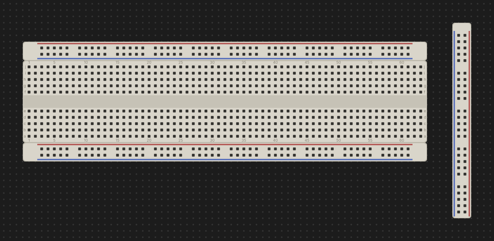

# The Desk & Breadboards

The desk is Chip Hippo's infinite, pannable, zoomable workspace — the place
every board, chip, wire, and power source lives. This page covers how to move
around the desk and how breadboards actually work under the hood: they are
not single parts but individual **strips** — a pin-board plus power rails —
that snap and mate together the way real boards do on a bench.

## Pan, zoom & fit to screen

The desk has no edges — pan and zoom to work at whatever scale suits the
circuit in front of you.

- **Pan**: hold `Space` and drag (from anywhere — over a board or a part
  too), hold `Option` (`Alt`) and drag anywhere that isn't a wire end, a
  movable leg or a routed wire, drag with the **middle mouse button**, or two-finger scroll on
  a trackpad. Both modifier pans work while the circuit runs too. A plain drag
  on empty desk doesn't pan: it draws a selection box
  (see [Selecting things](#selecting-things)). A quick *tap* of `Space` still
  runs and stops the circuit — it's only a pan while you hold it and drag.
- **Zoom**: scroll/pinch to zoom, centered on the pointer, or use the
  **+** / **−** buttons in the zoom control (bottom-right of the desk).
  Keyboard: `Option+Cmd/Ctrl+=` (zoom in), `Option+Cmd/Ctrl+-` (zoom out),
  `Option+Cmd/Ctrl+0` (reset to 100%). **Option is what makes these the
  desk's**: the same keys *without* it resize Chip Hippo's own text instead
  (see [Settings](settings.md#appearance)).
- **Fit to screen**: `Cmd/Ctrl+F` frames everything currently on the desk in
  the viewport — the fastest way to find your circuit after panning away. It
  also slides the whole design back around the middle of the desk, keeping a
  layout that has crept a long way out from drifting further; that part is a
  document edit (one `Cmd/Ctrl+Z` puts it back) and is skipped while the
  circuit is running.
- **Zoom out full**: `Cmd/Ctrl+Shift+F` zooms all the way out, useful for
  locating a part on a very large or sprawling layout.

A faint **dot grid** marks the 0.1 in hole pitch under everything you place;
it coarsens at low zoom and disappears entirely once you're zoomed out too
far for individual holes to matter. Zoom and pan position are remembered
between sessions.

## The desk padlock

A padlock sits in the desk's **top-right corner**, across from the tab strip.
Click it (or press `Cmd/Ctrl+L`) to shut it, and the **scroll wheel stops
reaching the desk**.

It exists for one input in particular. A Magic Mouse — and some trackpads —
reports a scroll from a finger merely resting on the surface, so the wheel is
the one thing that moves the desk without being asked to; midway through
seating a chip, that's a circuit that slides out from under you. Everything
else still works while it's locked: `Space`-drag and middle-drag panning, the zoom cluster, the
keyboard shortcuts above, and **Fit**. It's the wheel that's locked, not the
camera.

The padlock's shape changes rather than just its colour — an open shackle when
the wheel is live, a shut one when it isn't. It's **saved with the project**:
shut it, save, and the project reopens with the wheel still locked. Because
it's part of the file, changing it counts as an unsaved change, like renaming a
desktop. A new project starts with it open. The schematic view has a wheel of
its own and no padlock over it.

## Breadboards are strips

A real solderless breadboard is not one molded part — it's a centre
**pin-board** with one or two **power-rail** strips dovetailed onto its top
and bottom edges. Chip Hippo models this literally: each strip is its own
object on the desk, and what looks like "a breadboard" is a small **kit** of
strips placed together in one action.

The palette offers three assembled kits:

- **Full 830** — a full-length pin-board with a rail strip above and below.
- **Half 400** — the same layout at half length.
- **Tiny 170** — a bare pin-board only; the real 170-point part ships with no
  rails at all, so this kit is a single strip.

On a pin-board, rows run top to bottom as `j i h g f`, then the **trench**,
then `e d c b a`. The trench is the gap down the centre that isolates the top
half of each column from the bottom half electrically — a DIP chip **straddles
the trench**, with one row of pins in `f` and the other in `e` (or, for the
wide 600-mil chips, in two rows six holes apart — `h` and `d`, say), exactly as it would seat on a real board. A power-rail strip carries both a `+` and a `−`
line, each one continuous connection along its whole length, independent of
every other strip.

See [Chips & Components](components.md) for how chips and discretes seat into
the grid, and [Power & Clock Sources](power-and-clocks.md) for feeding a rail
from a PSU.

## Kits vs. loose strips

Below the assembled kits, the palette also offers the individual strips on
their own — a bare **Full pin-board**, a bare **Half pin-board**, a spare
**Full power rail**, a spare **Half power rail**, and a **Split power rail**.
Reach for these when a
board shipped without enough rails, when you want a rail somewhere a kit
wouldn't put one, or when you're building up a custom layout strip by strip.
Placing, ghosting, and overlap checking all work identically whether you're
dropping a whole kit or a single loose strip.

### The split power rail

A **Split power rail** is a full-length rail with both of its lines cut in the
middle, like the boards sold for circuits that need two supplies. Holes 1–25
and 26–50 of each line are separate connections, and the printed red and blue
stripes break at the cut so you can see where it is. Each half can take its
own supply — 5 V for the 74LS chips on the left, 9 V for the CD4000 chips on
the right, say — and its own [net name](probing.md#naming-a-net). It dovetails,
turns, and seats exactly like a Full power rail.

Jumpering the two **−** halves together is fine (two supplies normally share a
ground). Jumpering the two **+** halves together is not: two supplies set to
different voltages would then fight over one net, and the simulation reports
it as a fault (see
[Power & Clock Sources](power-and-clocks.md#two-supplies-on-one-desk)).

## Snapping & mating

Drop a strip within a couple of tenths of an inch of another strip it can
dovetail with — matching width when stacked, matching height side by side,
meeting flush with no gap — and it snaps into place automatically. This is
the same **magnetic pull** whether you're dragging a placed strip or holding
a fresh one from the palette; a whole kit snaps as one piece, and the pull
only ever engages when the snapped position is still legal (it will never
pull a strip into an illegal overlap).

Two strips that end up flush **mate**: they join a shared **group** and from
then on drag together as one rigid unit, just like a real breadboard's rails
stay attached to its pin-board when you nudge it on the bench. A kit arrives
pre-grouped; anything you drop flush against an existing board joins its
group (or merges two groups into one, if it bridges a gap). When several
strips are mated, `Cmd/Ctrl`-clicking any one of them selects the whole set —
the outline traces the union of the group's strips, so flush neighbours read
as one board rather than showing a seam between them.

## Selecting things

Every press on the desk follows one rule: **a click is just a drag that didn't
go anywhere.** Press on something and you've picked it up; let go in the same
place and it's set back down where it was — and the one thing that's changed
is that it's now selected, with everything else let go. Press and move, and
you're dragging it. There's nothing to learn about "clicking to select"
versus "dragging to move"; the only difference is whether the pointer
travelled.

What you press decides the rest:

- **On a part, wire, bus, flag or note** — that one thing becomes the
  selection, and a drag moves it. A wire's end, or a resistor's or LED's leg,
  counts as part of the thing it belongs to: pressing it grabs the whole wire
  or the whole part. (To grab *one* leg, see `Option` below.)
- **On empty desk** — a drag draws a **selection box**; a click clears the
  selection.
- **On a board's bare holes** — a click selects the **whole board**: every
  strip snapped to it, with everything seated on them riding along. A drag
  there still draws a selection box, so you can start one right across a
  board; the box only takes the board itself when it swallows it whole.
- **On a selected board's bare holes** — that drags the selection, board and
  all.

### Several things at once

- **Drag a box** from empty desk (or a board's holes). It *replaces* the
  selection with everything it encloses **completely** — a part only when its
  whole body is inside, a wire only when both ends (and every bend) are, a
  board only when the whole strip is. Anything the box merely grazes is left
  out on purpose: on a tight grid of holes, catching the neighbour by accident
  is more annoying than helpful.
- **`Cmd`-click** (`Ctrl`-click on Windows and Linux) an item to *add* it to
  the selection, or to take it back out if it's already in. This is how you
  pick up the four chips you actually want without drawing a box around the
  eight next to each other, and how you drop the one thing a box caught that
  you didn't mean. `Cmd/Ctrl`-clicking empty desk changes nothing — you just
  missed.

`Cmd/Ctrl`-clicking a **board** takes its whole snapped group. Clicking a
**bus** takes all of its member wires — a bus is bookkeeping over wires, and
the wires are what a delete or a copy acts on. Notes, labels, signal flags
and picked legs can't join a multi-selection, so `Cmd/Ctrl`-clicking one does
nothing; a plain click still selects it.

> **On macOS this is `Cmd`, not `Ctrl`** — the modifier the rest of the
> platform's lists use. `Ctrl`-click there is the system's secondary click, and
> it keeps that job: it still opens an item's context menu.

### A board carries its parts

A selected board takes everything seated on it along — its chips and parts,
and the wires running wholly on it — as **passengers**. Passengers ride with
the board when you move or delete it, but they aren't selected in their own
right, so **they aren't highlighted**: a highlighted part always means "this
part, selected for itself". If you'd already selected some chips and then add
their board, the chips drop out of the selection (they'll come along anyway);
take the board back out and they stay out — undo is the way back. Pressing a
passenger on its own is an ordinary click on it: that part alone becomes the
selection.

A box that covers only **part** of a board doesn't take the board. It takes
the parts that are wholly inside the box instead, each selected (and
highlighted) on its own.

### One leg at a time — `Option`

Hold **`Option`** (`Alt` on Windows and Linux) and the desk switches to
**pin targeting**: bodies stop reacting, and the only things you can pick are
the holes holding a lead that can move on its own — a **wire end**, a leg
of a **resistor, LED, capacitor, diode or other two-legged part**, or a leg of
a **TO-92 transistor**. Hover over one and its hole rings in **red**. A chip's
pins never light, nor do a TO-220's: a pin can't move apart from its body.

`Option`-click a red hole and that one lead becomes the whole selection (it
never adds to what was selected). `Option`-drag it to move just that lead to
another hole — the other end stays where it is. `Delete` with a leg picked
removes the part (or wire) it belongs to.

A **routed** wire answers `Option` too, anywhere along it that isn't an end:
`Option`-drag the run to add a bend there, or a bend to move it — the only
way to bend one, since a plain drag moves the whole wire (see
[Wire layout](wiring.md#wire-layout-direct-or-routed)).

To pick **several** leads, hold **`Cmd`** as well (`Alt+Ctrl` on Windows and
Linux): `Option+Cmd`-click a red hole adds that lead to the selection, and
clicking it again takes it back out. The leads can sit beside parts, wires and
boards in the same selection. Then drag — grab one of the ringed holes, or
anything else in the selection — and every picked lead moves with it: a wire
with one end picked stretches, a resistor or LED with one leg picked bends, and
anything whose other end is moving too travels whole. A lead whose wire or part
is already selected is covered by it, so picking it again changes nothing. A
plain `Option`-click still starts over with just that one lead.

### What a selection does

`Delete` removes **all of it in one go** — no questions, and one
`Cmd/Ctrl+Z` brings it all back. A selected board takes its passengers with
it, and a wire left with nothing at one end (because that end was in a
deleted board, or on a deleted PSU) goes too. `Cmd/Ctrl+C` copies the
selection (as a whole design, if it includes boards — see
[Projects & Desktops](projects-and-desktops.md)), `Esc` clears it, and
`Cmd/Ctrl+A` selects the entire desk.

**A selection also moves as one.** Grab anything in it and the whole set —
boards, parts, wires — travels by the same amount, keeping the arrangement
you built. The thing under your pointer snaps to the hole grid and everything
else follows exactly. Wiring comes along: a wire with both ends on what's
moving moves with it, and a wire with one end left behind **stretches** — the
moving end follows its part to the new hole and the other stays put, so
nothing is quietly disconnected. The drop is **all or nothing**: if anything
in the set can't land (a pin over a taken hole, a board on top of another),
the whole selection springs back. Hold **`Shift`** as you press to move it
**bare** instead: only what you selected moves, and the wiring plugged into it
stays where it is. See [Moving several parts at
once](components.md#moving-several-parts-at-once) for the details.

**Undo covers your clicks too.** Each change of selection is a step in the
undo history, so a misclick that threw away a careful selection is one
`Cmd/Ctrl+Z` away from coming back.

Nothing can be selected while the simulation is **running** — the topology is
frozen, so a selection would be one you couldn't act on. (Clicking a wire still
highlights it, to trace where it runs.)

## Groups & breaking a snap

Moving a selected board moves exactly the strips that are selected.
`Cmd/Ctrl`-clicking a board selects its whole snapped group, so the kit moves
as one, just like a real breadboard's rails stay attached to its pin-board.

To **pull a strip off** its group, select just that strip: draw a box around
the pin-board (and its parts) but not the rail beside it, then drag. The strip
peels away from the rail left behind, and every wire running between them
**stretches** across the new gap — the connection survives the separation.
When you drop it, both the piece you moved and what's left of the group are
re-evaluated, each split into fresh groups based on what's still actually
mated within it. Dropping strips flush against each other mates them again.

## Rotating a rail

**Power rails can rotate; pin-boards cannot.** A pin-board's trench (and
every DIP seated across it) only makes sense in one orientation, so it's
locked at 0°. A rail strip is just two parallel lines of holes, so it reads
the same standing on end — turned 90° it becomes a vertical **signal bus**
you can run alongside a board and tap into at any point along its length.

Press `R` while a rail is in hand (mid-placement, before you click it down)
to cycle its rotation through 0°/90°/180°/270°. Once a strip is placed its
angle is fixed; to change it, pick it up again. Rotating doesn't change
anything electrically — a rail is one continuous node however it's turned
(each half is, on a split rail) — it only changes which way the strip's
footprint runs on the desk.

---

Next: [Chips & Components](components.md) for populating a board, or
[Wiring, Nets & Buses](wiring.md) for connecting everything up.
